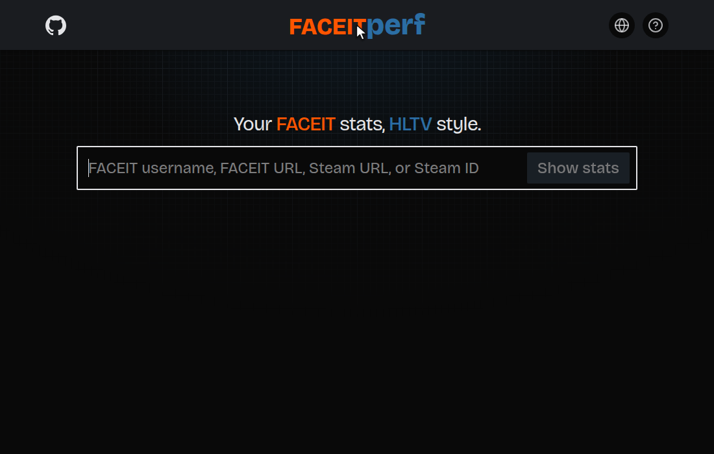

# faceitperf

Your FACEIT stats, HLTV style: **[faceitperf.pro](https://faceitperf.pro)**

Look up any FACEIT player and see their matches the way HLTV shows them: Rating 2.0, KAST, ADR and more, map by map.

## How the rating works

FACEIT has no Rating 2.0, so faceitperf recreates it from HLTV's own data. On pro careers, it typically lands within 0.01 of HLTV's number. [Here's how.](tools/rating/README.md)

## Contact

Questions or ideas? Message me on Telegram at [@iffypixy](https://t.me/iffypixy), or email ansat.euler@gmail.com.

Not affiliated with FACEIT or HLTV.
